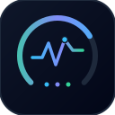
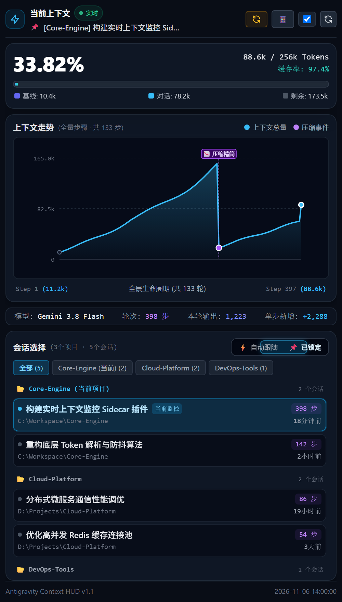

# Antigravity Context Monitor

<p align="center">
  
</p>

<p align="center">
  <b>Google Antigravity 2.0 原生侧边栏上下文与 Token 实时监控插件</b>
</p>

<p align="center">
  
  
  
</p>

<p align="center">
  
</p>

---

## 项目简介

在长程编码、批量文件检索与多轮迭代场景中，上下文膨胀是引发模型响应降级与自动截断压缩的主要因素。

Antigravity Context Monitor 依托 Antigravity 原生 UI Sidecar 架构构建，独立运行于辅助窗格中。它在不侵入对话上下文、不消耗对话 Token 的前提下，实时解析会话日志，提供可视化的上下文占用比例、全生命周期演进走势及自动瘦身压缩监测。

---

## 核心功能

- **256k 真实窗口基准**：严格基于 Antigravity 实际上下文限制（262,144 Tokens）计算占用率与可用余量，精准反映触发自动压缩的阈值状态。
- **全生命周期上下文走势**：提取从初始步骤至当前轮次的全程曲线，支持鼠标悬停十字准星探针查看历史步骤的上下文增量与工具调用，并在系统触发上下文瘦身时自动标注压缩事件与下落幅度。
- **自动跟随与会话锁定**：集成双态可视化切换开关。默认采用交互优先的防抖跟随算法实时追踪最新活跃会话，避免后台文件写入引起的列表跳动；亦支持手动锁定固定会话持续观测。
- **按项目聚合与会话管理**：自动根据工作区与项目归类历史会话，提供项目标签筛选与一键切换。
- **零外部依赖**：后端完全基于 Python 3 标准库（`http.server`、`sqlite3`、`json`），前端采用原生 HTML5 与矢量 SVG，无需执行任何 `pip install` 即可开箱即用。

---

## 安装指引 (Windows)

### 环境要求
- Windows 10 / 11
- Python 3.8+（支持 Windows 官方 `py` 启动器）
- Google Antigravity 2.0+

### 方式 1：直接让 Agent 自动安装（推荐 · 免切终端）
直接复制以下一句话发送给当前对话中的 Agent 即可全自动安装完成：

> 帮我安装当前上下文监控插件：https://github.com/Summer-kk/antigravity-context-monitor.git

### 方式 2：手动终端安装（PowerShell）
在 PowerShell 中执行以下命令，将插件克隆至 Antigravity 用户插件目录：

```powershell
git clone https://github.com/Summer-kk/antigravity-context-monitor.git "$HOME\.gemini\config\plugins\context-monitor"
```

克隆完成后无需重启主程序，插件将自动加载。

---

## 使用方式

1. **界面直接打开**：
   打开侧边栏 -> 扩展 -> 当前上下文监控 即可直接唤起监控面板。

2. **协议链接直达**：
   在任意对话中直接点击下方协议链接，即可在辅助窗格中唤起监控面板：
   `sidecar://context-monitor/context-hud/`

3. **通过 Agent 自然语言交互**：
   在对话中向 Agent 发送如下指令，Agent 将自动提供侧边栏入口：
   - “查看当前上下文占用”
   - “检查当前会话 Token 健康度”
   - “打开上下文走势图”

---

## 架构与文件结构

```text
antigravity-context-monitor/
├── .gitignore               # Git 忽略规则清单
├── LICENSE                  # MIT 开源许可证
├── README.md                # 项目文档
├── plugin.json              # 插件核心清单与元数据
├── assets/
│   ├── logo.svg             # 插件矢量图标 (128x128)
│   ├── preview.png          # 视网膜高清脱敏预览图
│   └── preview.html         # 离线交互演示页面
├── rules/
│   └── AGENTS.md            # Agent 行为规范与侧窗入口指引
└── sidecars/
    └── context-hud/
        ├── sidecar.json     # Sidecar 启动规格与命令配置 (command: "py")
        ├── server.py        # 本地 HTTP 路由服务与热重载接口
        ├── engine.py        # 会话日志解析、Token 统计与防抖排序引擎
        └── index.html       # 原生 HUD 前端界面
```

---

## 开源协议

本项目遵循 [MIT License](LICENSE) 开源协议。
